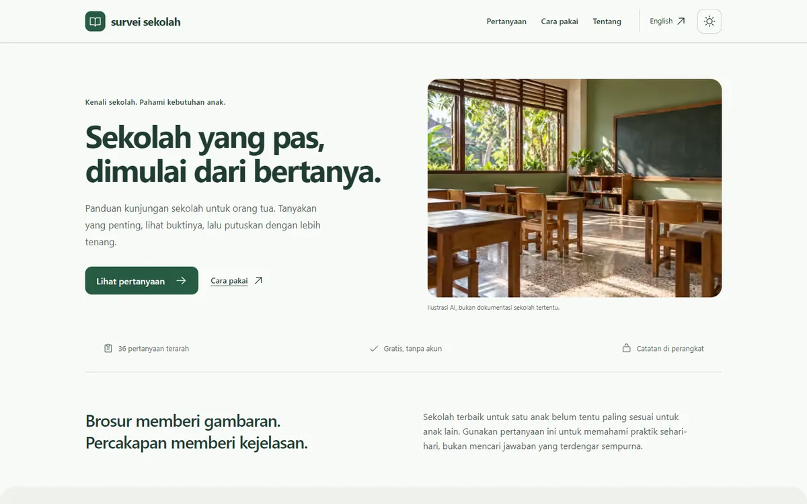

# Survei Sekolah

**Sekolah yang pas, dimulai dari bertanya.**

Panduan kunjungan sekolah di Indonesia untuk orang tua dan wali. Bawa pertanyaan yang relevan, minta contoh nyata, lalu bandingkan kecocokan sekolah dengan kebutuhan anak.

[Buka situs](https://surveisekolah.rezaprama.com) · [English](docs/README.en.md) · [36 pertanyaan lengkap](docs/pertanyaan.md)



## Mulai dari yang penting

1. Buka [checklist interaktif](https://surveisekolah.rezaprama.com/#tanya). Mulai dengan **12 pertanyaan inti** atau pilih semua pertanyaan.
2. Beri nama catatan sekolah. Buka pertanyaan untuk melihat alasan dan bukti yang bisa diminta.
3. Tandai jawaban sebagai *belum dibahas*, *sudah jelas*, *tanya lagi*, atau *tidak relevan*. Tambahkan catatan seperlunya.
4. Buat hingga tiga catatan sekolah, lalu pilih **Bandingkan**. Bahas bukti dan kebutuhan anak bersama keluarga.
5. Cetak sesuai filter aktif, unduh catatan Markdown, atau buat cadangan JSON untuk dibuka di perangkat lain.

Jumlah jawaban yang sudah jelas **bukan skor mutu sekolah**. Tidak ada peringkat otomatis, iklan sekolah, atau formulir pengumpulan jawaban.

## Yang bisa ditanyakan

| Topik | Contoh pertanyaan |
| --- | --- |
| Belajar | Bagaimana anak belajar? Apa bantuan saat kesulitan? Bagaimana kebutuhan yang beragam didukung? |
| Aman | Bagaimana laporan perundungan ditangani? Siapa penjemput yang berizin? Apa rencana bencana? |
| Guru | Berapa anak per kelas? Bagaimana guru didukung dan dilatih? |
| Keseharian | Bagaimana toilet, waktu makan, kantin, camilan, dan MBG dikelola? |
| Keluarga | Bagaimana kabar anak disampaikan? Siapa yang boleh memakai foto dan data anak? |
| Biaya & akses | Berapa total biaya? Apa syarat masuk? Apakah fasilitas dan perjalanan dapat diakses? |

<details>
<summary><strong>Lihat 12 pertanyaan inti</strong></summary>

- Bagaimana anak belajar setiap hari?
- Berapa anak dan guru dalam satu kelas?
- Apa yang terjadi saat anak melaporkan perundungan?
- Siapa yang mengawasi anak di luar kelas?
- Bagaimana kabar perkembangan anak disampaikan?
- Siapa yang memberi pertolongan saat anak cedera?
- Apa bantuan saat anak kesulitan belajar?
- Bagaimana identitas penjemput diverifikasi?
- Berapa total biaya satu tahun?
- Bagaimana kebutuhan belajar yang beragam didukung?
- Apa rencana saat gempa, banjir, atau kebakaran?
- Bagaimana alergi dan kondisi kesehatan ditangani?

</details>

Daftar lengkap tersedia dalam [bahasa Indonesia](docs/pertanyaan.md) dan [bahasa Inggris](docs/questions.md). Keduanya dibuat dari sumber konten yang sama dengan situs.

## Dasar penyusunan

Panduan bermula dari **25 topik dalam dua foto catatan** di [sumber/](sumber/). Seluruh topik dipertahankan dan diberi nomor sumber. Sebelas tambahan membahas biaya, identitas sekolah, inklusi, bencana, alergi, privasi, teknologi, disiplin, penerimaan, pengembangan guru, dan aksesibilitas.

Pertanyaan disunting menjadi netral. Keikutsertaan MBG, nama kurikulum, AC, CCTV, dan akreditasi tidak dijadikan penentu tunggal mutu sekolah. Mintalah penjelasan, dokumen yang relevan, serta contoh praktik.

Ini panduan mandiri oleh Reza Prama, bukan instrumen yang telah divalidasi, survei statistik, akreditasi, atau rekomendasi sekolah tertentu. Sesuaikan untuk PAUD/TK, SD, SMP, atau SMA/SMK. [Metode dan peta sumber](docs/metode.md).

## Privasi

Catatan menggunakan `localStorage` pada browser dan domain yang sama. Jawaban tidak dikirim ke basis data proyek. Tidak ada akun, pelacak iklan, atau analitik yang ditambahkan oleh proyek. Hosting tetap memproses permintaan dan data koneksi untuk menyajikan situs.

- Indonesia dan Inggris berbagi catatan pada browser dan domain yang sama.
- Perangkat atau profil browser lain tidak tersinkron otomatis.
- Cadangan JSON berisi seluruh catatan; simpan dan pindahkan secara pribadi.
- Hindari nama anak, diagnosis terperinci, nomor identitas, dan data sensitif lain.
- Perangkat bersama dapat membuka catatan. Hapus data situs untuk menghapus catatan lokal; hapus salinan unduhan secara terpisah.
- Jika penyimpanan ditolak atau penuh, situs menampilkan pesan dan tetap menyediakan unduhan cadangan.

## Pengembangan

Node.js 22 atau lebih baru. HTML statis, CSS, JavaScript biasa, dan aset lokal. Tidak ada framework JavaScript yang dikirim ke pengunjung.

```sh
npm ci
npm run dev
```

Preview: `http://127.0.0.1:8787`. Server Node lokal menyajikan header keamanan dan kompresi gzip; produksi menggunakan Cloudflare Static Assets.

```sh
npm run check          # validasi konten, cadangan, dan build
npm run test:browser   # interaksi, bahasa, layout, tema, cetak, tanpa JS
npm run audit          # Lighthouse mobile + desktop, Indonesia + Inggris
npx wrangler deploy --dry-run
npm run deploy
```

Tes browser dan audit memakai Chrome terpasang. Set `CHROME_PATH` jika lokasi berbeda. Set `TEST_URL` atau `AUDIT_URL` untuk memeriksa situs publik. Audit menghasilkan HTML dan JSON di `reports/`; [ringkasan terbaru](reports/summary.json) mencatat URL, versi alat, waktu, dan skor.

Konten utama: [src/questions.mjs](src/questions.mjs). Terjemahan dan teks antarmuka: [src/copy.mjs](src/copy.mjs). `npm run build` memperbarui HTML kedua bahasa dan panduan Markdown secara bersamaan.

## Cloudflare dan GitHub

Produksi: **[surveisekolah.rezaprama.com](https://surveisekolah.rezaprama.com)**. Konfigurasi: [wrangler.jsonc](wrangler.jsonc). Cloudflare Workers Static Assets menyajikan situs. Worker kecil mengompres HTML dengan gzip agar header privasi `no-transform` tetap dipertahankan; gambar dan aset lain melewati handler ini. Tidak ada API penerima catatan, D1, atau layanan berbayar tambahan yang dikonfigurasi proyek. Permintaan HTML memakai kuota Worker pada akun hosting.

GitHub Actions menjalankan pemeriksaan pada push dan pull request. Deployment pertama dijalankan melalui Wrangler dari lingkungan pemilik. Workflow **Deploy** tersedia secara manual setelah secret `CLOUDFLARE_API_TOKEN` di environment `production` diisi dengan token khusus deployment. `CLOUDFLARE_ACCOUNT_ID` dapat diisi sebagai variable; account ID juga tercantum dalam konfigurasi. Token tidak disimpan di repository. Push tidak otomatis mengubah situs produksi.

## SEO dan keterbacaan mesin

Halaman bahasa Indonesia memakai `/`, Inggris memakai `/en/`. Keduanya memiliki canonical, hreflang, judul dan deskripsi tersendiri, Open Graph, serta JSON-LD `WebSite` dan `CollectionPage`. Semua pertanyaan tersedia dalam HTML tanpa bergantung pada JavaScript.

Tersedia [sitemap](https://surveisekolah.rezaprama.com/sitemap.xml), [robots.txt](https://surveisekolah.rezaprama.com/robots.txt), [Markdown](https://surveisekolah.rezaprama.com/guide.md), [JSON](https://surveisekolah.rezaprama.com/questions.json), dan [llms.txt](https://surveisekolah.rezaprama.com/llms.txt). Berkas terakhir adalah bantuan navigasi konten, bukan jaminan kemunculan di mesin pencari AI.

Skor Lighthouse adalah hasil uji laboratorium pada waktu dan kondisi tertentu, bukan jaminan skor PageSpeed setiap saat. GEO tidak memiliki satu skor resmi universal 100/100; proyek mengutamakan konten yang jelas, dapat dirujuk, dan tidak melebih-lebihkan bukti. Lihat [catatan pengujian](docs/uji.md).

## Kredit dan kontribusi

Ilustrasi dibuat dengan alat imagegen bawaan, bukan dokumentasi sekolah tertentu. Aset terkompresi dan [prompt serta asal aset](docs/aset.md) disimpan di repository. Font DM Sans dan ikon Phosphor dihosting sendiri; lisensi masing-masing ikut dalam output situs.

Perbaikan pertanyaan, terjemahan, dan aksesibilitas dapat diajukan melalui issue atau pull request. Jangan menyertakan data pribadi anak atau tuduhan terhadap sekolah tertentu. Kode dan konten baru proyek memakai [lisensi MIT](LICENSE); foto sumber yang diberikan pemilik tidak termasuk izin penggunaan ulang tersebut.
